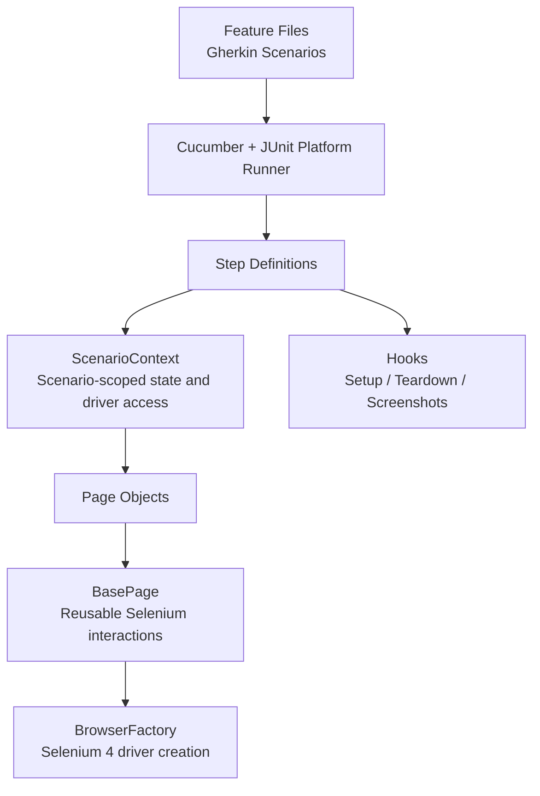
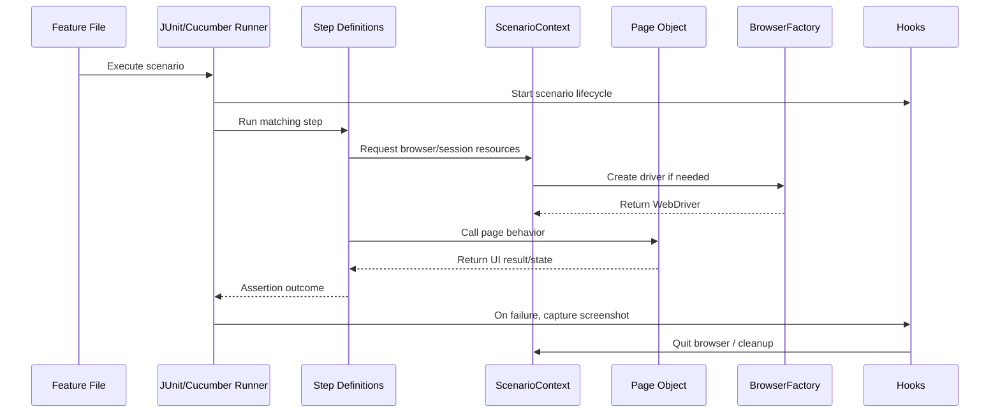
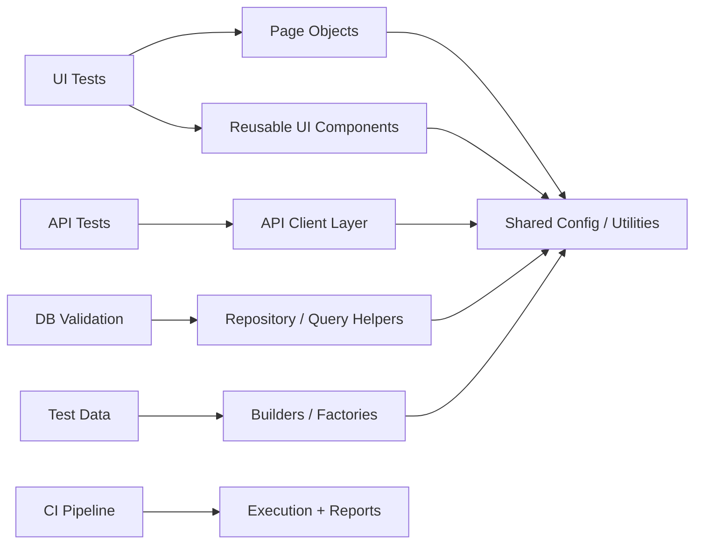

# Framework Architecture Guide

This document demonstrates a **modern Java UI automation architecture** built with **Selenium 4, Cucumber, JUnit Platform, Maven, and the Page Object Model (POM)**.

---

## 1) Purpose of this framework

This project was designed to show how I structure a maintainable UI automation solution that is:

- **Readable** for business and QA stakeholders through Cucumber feature files
- **Maintainable** through Page Object Model design
- **Scalable** through clear separation of concerns
- **Stable** through explicit waits and scenario-level isolation
- **CI-friendly** through Maven and GitHub Actions integration
- **Recruiter-friendly** through a small but realistic working example

The framework includes a self-contained sample login flow using a local HTML page so the demo can be understood quickly without depending on an external application.

---

## 2) High-level architecture



### What this means

- **Feature files** describe behavior in business-readable language.
- **Step definitions** translate behavior into automation logic.
- **ScenarioContext** manages scenario-level dependencies and browser access.
- **Page objects** contain page behavior and locators.
- **BasePage** centralizes reusable Selenium interactions and explicit waits.
- **Hooks** handle lifecycle responsibilities such as cleanup and screenshot capture.
- **BrowserFactory** provides cross-browser WebDriver initialization.

---

## 3) Project structure

```text
modern-cucumber-junit-framework
│
├── ARCHITECTURE.md
├── README.md
├── pom.xml
├── .github/
│   └── workflows/
│       └── tests.yml
└── src/
    └── test/
        ├── java/
        │   └── dev/example/automation/
        │       ├── config/
        │       │   └── TestConfig.java
        │       ├── core/
        │       │   ├── BrowserFactory.java
        │       │   ├── ScenarioContext.java
        │       │   └── UrlResolver.java
        │       ├── hooks/
        │       │   └── ScenarioHooks.java
        │       ├── pages/
        │       │   ├── BasePage.java
        │       │   └── LoginPage.java
        │       ├── runner/
        │       │   └── RunCucumberTest.java
        │       └── steps/
        │           └── LoginSteps.java
        └── resources/
            ├── demo/
            │   └── login.html
            ├── features/
            │   └── login.feature
            └── junit-platform.properties
```

---

## 4) Core design principles

### A. Page Object Model (POM)
The framework uses **Page Object Model** design to separate test behavior from page implementation details.

**Why it matters:**
- Locators are centralized
- UI changes are easier to maintain
- Tests remain readable
- Reuse increases across scenarios

### B. Separation of concerns
Each layer has a clear responsibility:

| Layer | Responsibility |
|---|---|
| Feature files | Define business behavior |
| Step definitions | Glue between Gherkin and code |
| Page objects | Encapsulate UI interactions |
| BasePage | Shared Selenium utilities |
| Hooks | Setup/teardown and failure handling |
| Config/core | Framework infrastructure |

### C. Scenario isolation
Each test scenario gets its own state and browser lifecycle.

**Why it matters:**
- Reduces side effects between tests
- Improves reliability
- Supports safer future parallel execution

### D. Explicit waits over implicit waits
The framework favors **explicit waits** for stable synchronization.

**Why it matters:**
- Less flakiness
- Clearer intent
- More predictable UI automation behavior

### E. Generic and reusable architecture
The framework is intentionally not tied to a single application domain.

**Why it matters:**
- Easier to adapt to enterprise applications
- Better as a reusable starter framework
- Demonstrates architecture thinking rather than one-off scripting

---

## 5) Execution flow

This diagram shows what happens when a scenario runs.



---

## 6) How the main classes work together

### `RunCucumberTest.java`
Acts as the JUnit Platform entry point for executing Cucumber scenarios.

### `LoginSteps.java`
Contains the step definitions. These methods remain intentionally thin and readable. They call page-level behavior rather than handling WebDriver details directly.

### `ScenarioContext.java`
Owns scenario-scoped state and lazy driver access. This keeps each scenario independent and avoids global mutable driver usage.

### `BrowserFactory.java`
Creates browser instances using Selenium 4 and Selenium Manager.

### `BasePage.java`
Provides reusable interactions such as:
- click
- type
- read text
- explicit wait handling

This avoids duplication across page objects.

### `LoginPage.java`
Represents the sample login page.

This class stores:
- page locators
- behavior-oriented methods such as `login()`
- validation helpers specific to the page

### `ScenarioHooks.java`
Handles teardown and failure support, such as:
- screenshot capture on failure
- guaranteed browser cleanup

### `TestConfig.java`
Centralizes configuration access so runtime values can come from system properties or environment variables.

---

## 7) Why this framework is a strong sample

This framework demonstrates more than just working code. It shows engineering judgment.

### Strengths showcased

- **Modern stack**: Selenium 4, Cucumber 7, JUnit Platform
- **POM-based design**: cleaner organization and better maintainability
- **Scenario-scoped dependency management**: avoids static global driver patterns
- **Self-contained demo**: easy to review without extra setup complexity
- **Clean layering**: step definitions are not overloaded with Selenium logic
- **CI-ready**: includes workflow support for automated execution
- **Readable for multiple audiences**: QA, SDET, and hiring teams can follow it


## 7) Sample extension path for enterprise use

This project is intentionally compact, but it is structured so it can be expanded.

### Typical next steps

1. Add additional page objects for more application areas
2. Add reusable UI components (menus, tables, dialogs, headers)
3. Add test data builders / factories
4. Add environment profiles (QA, UAT, staging, prod-like)
5. Add REST API test modules with REST Assured
6. Add database validation helpers
7. Add richer reporting and dashboards
8. Add parallel execution after validating environment stability
9. Add retry strategy carefully where appropriate
10. Add containerized execution for CI portability

### Example expanded architecture



---

## 9) Why a local sample application was used

The included sample uses a local `login.html` file rather than a live web application.

### Reasoning
- Avoids relying on unstable external sites
- Makes the demo deterministic
- Allows the framework structure to be the focus
- Makes recruiter review easier

The framework is still designed so the `base.url` can be replaced with a real test environment when adapting it to a production application.

---

## 10) How to run the framework

### Default execution
```bash
mvn clean test
```

### Run headed
```bash
mvn clean test -Dheadless=false
```

### Run with browser selection
```bash
mvn clean test -Dbrowser=chrome
mvn clean test -Dbrowser=firefox
mvn clean test -Dbrowser=edge
```

### Run against another target URL
```bash
mvn clean test -Dbase.url=https://your-test-environment.example/login
```

---

## 11) Final summary

This framework is a **modern, generic UI automation starter** that demonstrates:

- Java test automation design skills
- BDD with Cucumber
- Page Object Model implementation
- Selenium 4 best practices
- Scenario isolation and maintainability
- CI-ready project organization

It is intentionally concise, but it reflects how I would structure a more complete automation framework for real-world use.

---

## 12) Contact / review note

1. `README.md`
2. `ARCHITECTURE.md`
3. `pom.xml`
4. `src/test/java/dev/example/automation/pages/BasePage.java`
5. `src/test/java/dev/example/automation/pages/LoginPage.java`
6. `src/test/java/dev/example/automation/steps/LoginSteps.java`
7. `src/test/resources/features/login.feature`

These files give the clearest overview of the framework design and coding approach.
